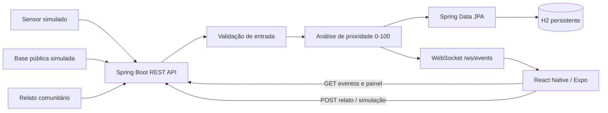

# Arquitetura e decisões técnicas

## Diagrama

## Componentes

- **Entidade `RiskEvent`**: identificador, localização urbana, tipo, severidade, impacto, origem, confiança, pontuação e horário.
- **Controller**: `/api/events`, `/api/alerts`, `/api/dashboard`, `/api/health` e `/api/demo/simulate`.
- **Service**: regras de priorização e transformação para DTO, persistência e broadcast.
- **Repository**: acesso aos registros via Spring Data JPA.
- **WebSocket**: publicação de `EVENT_CREATED` e batimentos `HEARTBEAT`, com envio aos clientes online.
- **Mobile**: busca inicial e fallback periódico, atualização imediata via WebSocket, reconexão após falha e avisos de risco.

## Indicadores propostos

| Indicador | Método de avaliação | Meta ilustrativa, não medida |
| --- | --- | --- |
| Tempo de atualização | Medir segundos entre POST e alerta renderizado no app (gravar em vídeo com relógio) | Menor que 3s na rede local |
| Qualidade dos alertas | Revisar se altos/críticos condizem com severidade/impacto de cenários conhecidos | 100% de cenários de teste classificados corretamente |
| Facilidade de uso | Solicitar a 3 colegas localizar alerta e enviar relato; medir conclusão | 3/3 tarefas concluídas sem instrução adicional |
| Recuperação | Parar API, observar aviso e religar; verificar retorno automático | Status deve mudar e a UI não deve travar |

*Estas são metas para teste futuro, não resultados obtidos.*

## Confiabilidade e privacidade

- `confidence`: nível de confiança do dado de 0 a 1; a origem é registrada no campo `origin` e classificada em `sourceType`.
- A comunidade informa relato anônimo com 0,65 de confiança inicial, propositalmente inferior a sensores e fontes oficiais simulados.
- Não capturamos identificadores pessoais no formulário; o registro usa apenas bairro/região (dados geográficos amplos).
- Segurança de produção ainda exigiria autenticação, autorização por papéis, HTTPS/WSS, audit logs, validação de fontes, proteção contra spam, revisão LGPD e CORS restrito.
- H2 local não é uma arquitetura horizontalmente escalável. Evolução: PostgreSQL, fila/event broker, separação de instâncias e cache.
- A análise é heurística; `RiskScoring` usa pontuação transparente em vez de um modelo estatístico treinado, e a atualização de pontuações ocorre a cada minuto.

## Comportamento de falha

- Quando o backend cai, o WebSocket fecha, o app mostra aviso e mantém eventos da última sincronização na memória.
- O app tenta reconectar via WebSocket a cada 3 segundos.
- Um polling de 8 segundos serve de fallback de atualização e ajuda a detectar indisponibilidade.
- Ao restabelecer o WebSocket, a API é consultada novamente para recuperar eventos perdidos.
- Dados históricos ficam no H2, gerado automaticamente na primeira execução do backend.

## Limitações documentadas

Dados de exemplo são simulados, não alimentados por serviços públicos reais. O envio de POST está aberto para a demo em LAN. As notificações nativas implementadas são locais, após consentimento e com app aberto/ativo; não implementamos push remoto via FCM/APNs nem distribuição garantida em background. Integração e desempenho fim a fim precisam ser confirmados no computador e telefone da equipe.
